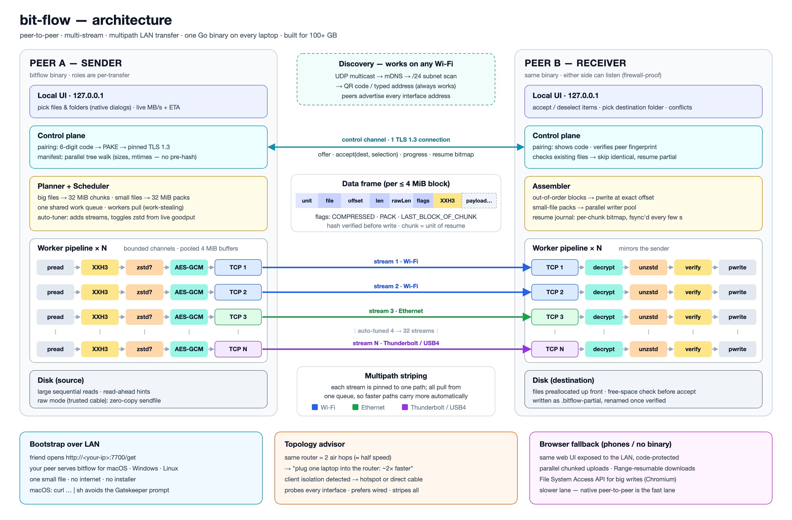

# bit-flow — Architecture

> Laptop → laptop, 100+ GB (games, big files), over any Wi‑Fi or cable, as fast as the link physically allows.



---

## 1. The physics first (where speed actually comes from)

No software can make the air faster. Over Wi‑Fi the radio is the ceiling, so the job is to
**(a) pick the best physical path, (b) keep that path 100% saturated, and (c) send fewer bytes.**

The biggest hidden cost: when both laptops are on the same router, every byte crosses the air
**twice** (A → router → B), and both hops share the same airtime. That roughly halves the speed.

Rough real-world numbers for **100 GB** (TCP goodput, good conditions):

| Path                                             | Throughput       | 100 GB takes |
|--------------------------------------------------|------------------|--------------|
| Wi‑Fi 5, both laptops on router (2 air hops)     | ~30–40 MB/s      | ~45–55 min   |
| Wi‑Fi 6, both laptops on router (2 air hops)     | ~50–90 MB/s      | ~20–35 min   |
| Wi‑Fi 6, **one laptop plugged into router**      | ~100–150 MB/s    | ~11–17 min   |
| Gigabit Ethernet cable, laptop ↔ laptop          | ~112 MB/s        | ~15 min      |
| 2.5 GbE USB adapters, laptop ↔ laptop            | ~280 MB/s        | ~6 min       |
| Thunderbolt / USB4 cable (IP over Thunderbolt)   | 1–2.5 GB/s       | ~1–2 min (disk-bound) |

Takeaways baked into the design:
- **Saturate**: multiple parallel TCP streams + deep pipelining, so disk, CPU, and network all stay busy at once.
- **Multipath**: if two paths exist (Wi‑Fi + cable), stripe across both at the same time.
- **Fewer bytes**: adaptive compression when the link (not the CPU) is the bottleneck, and skip files the receiver already has.
- **Topology advice**: detect the double-hop / blocked-network cases and tell the user the one change that helps most.

## 2. Prior art (what we borrow, what we beat)

| Tool | How it works | Lesson for bit-flow |
|------|--------------|---------------------|
| **Steam LAN game transfer** | Steam client pulls game files from a LAN PC | Capped around 100 MB/s, often half that in practice. Beatable. Also: copying `steamapps/common/<game>` + `appmanifest_<id>.acf` makes Steam recognize the game. |
| **LocalSend** (open source) | REST over HTTPS, UDP multicast discovery with HTTP fallback, PIN | Copy the discovery strategy (multicast → fallback scan). Either side can be the server, which gets around firewalls. |
| **croc** (Go) | PAKE short-code pairing, relay, resume | Copy PAKE pairing + resume. Skip the relay; we're LAN only. |
| **PairDrop / Snapdrop** | Browser WebRTC | Good for phones; too slow/limited for 100 GB. Use it only as a fallback idea. |
| **Resilio Sync** (paid) | BitTorrent-style block sync | Content-addressed chunks, skipping blocks the receiver already has. |
| **Aspera / Raysync** (paid) | Custom UDP protocols | Built for long-latency WAN links. On a LAN, multi-stream TCP is just as fast and much simpler, so we skip custom UDP. |

## 3. Core decisions

| Decision | Choice | Why |
|----------|--------|-----|
| Topology | **Peer-to-peer, one binary on both laptops** | A browser can't do raw multi-socket TCP or `pwrite` into preallocated 100 GB files. A native peer can, and it can open real folder pickers on both sides. |
| Language | **Go** | Goroutines map 1:1 to the worker/stream model. Pure-Go builds cross-compile to macOS/Windows/Linux from one machine (`CGO_ENABLED=0`). Stdlib TLS 1.3, very fast zstd and XXH3 libraries, and automatic `sendfile`. Go handles 10 GbE easily, far above Wi‑Fi. Rust would only matter beyond that. |
| Transport | **N parallel TCP streams** (not QUIC/UDP) | On a LAN, TCP is kernel-optimized and offloaded to the network card. Userspace QUIC uses more CPU per byte. Several streams cover Wi‑Fi packet loss and fill the radio's frame batching. |
| UI | **Local web UI on 127.0.0.1**, served by the binary | Pretty and cross-platform. The binary does the real work and opens native OS dialogs, so both sender and receiver pick real paths. Vanilla HTML/JS embedded with `go:embed`: no Node toolchain. |
| Fallback | Browser-only mode for phones / no-install | The slower lane. Native peer-to-peer is the fast lane. |

## 4. Components

### 4.1 Discovery — "works on any Wi‑Fi"
A scan sends one small JSON query several ways at once, repeated 3× over ~1.5 s (Wi‑Fi drops UDP):
1. **UDP multicast** to 224.0.0.177:7700, sent out each interface.
2. **Directed broadcast** for each local subnet, plus 255.255.255.255.
3. Responders (receivers, waiting senders, the app) **answer by unicast** with `{id, name, os, port, role}`.
4. If nothing answers: **TCP probe** of every address in each local /24 (`KindProbe` hello, ~1 s, 128 at a time).
5. Typed address or device name: always works if the two laptops can route to each other at all.

Responders always listen on UDP 7700 (SO_REUSEPORT, so several bit-flow processes can share it) and
advertise their real TCP port. Device IDs are random and stored in the config dir. A scanner ignores itself.

**Either side can listen.** Connection setup is separate from the session: normally the receiver listens,
but `send --wait` makes the sender listen and the receiver fetch (`recv --from`). The dialer is always the
PAKE "dialer" and TLS client. Data streams follow the same rule. So a firewall on one laptop never blocks a transfer.

### 4.2 Pairing & security
- The receiver shows a **6-digit code**, and the sender passes it (`--code`) or is prompted for it.
- The code feeds **CPace** (`filippo.io/cpace`, a balanced PAKE over ristretto255). Both sides get a shared key,
  eavesdroppers learn nothing, and an active attacker gets one guess per connection (no offline brute force).
- Each side MACs the handshake transcript plus its ephemeral self-signed certificate's SHA-256 fingerprint with
  a key derived from the PAKE key. A wrong code is detected right there on both sides.
- The control connection then upgrades to **TLS 1.3**, with both certificates pinned to the exchanged fingerprints.
  Every data stream does the same. Go uses AES-GCM with hardware AES: 2.8 GB/s per stream on an M4.
- **Raw mode** (`send --raw` + `recv --allow-raw`, trusted direct cable only): data streams skip TLS but must
  present `HMAC(key, session‖stream)`, so they're authenticated, just not encrypted.
- Online guessing: 5 wrong codes rotate the code, and every failure costs 1 s while pairing attempts are serialized.
- Filenames are sanitized on the receiver (no `..`, absolute paths, or reserved Windows names).

### 4.3 Control plane (1 TLS connection)
Length-prefixed binary messages (msgpack):

```
HELLO        version, device name, OS, interfaces[], capabilities
OFFER        manifest (tree, sizes, mtimes, modes), total bytes, file count
ACCEPT       dest root, selected subset, conflict policy, have-bitmap (resume)
REJECT
STREAM_PLAN  stream count, path assignment (which interface per stream)
PROGRESS     receiver → sender: bytes committed, chunk acks (drives auto-tuner)
TUNE         add/remove streams, compression on/off
DONE         per-file BLAKE3 roots, final stats
```

**Both sides choose**:
- **Sender** picks files/folders through native dialogs or drag-and-drop.
- **Receiver** gets the offer, picks the destination folder, can deselect items, and sets the conflict
  policy (skip identical / rename / overwrite).

The receiver also checks free space before accepting.

### 4.4 Planner & scheduler (sender)
- **Manifest walk**: a parallel directory walker (worker pool). It does **not** pre-hash anything, since
  reading 100 GB twice would double the time. Hashing happens inline as data streams.
- Work units:
  - **Chunk** = 32 MiB slice of a large file. This is the unit for scheduling and resume. 100 GB ≈ 3,200 chunks.
  - **Pack** = whole small files (≤ 1 MiB each) concatenated into one frame of ≤ 4 MiB. Games ship tens of
    thousands of small files, and per-file round trips would kill throughput.
- One **shared work queue**. Workers pull the next unit as they free up (work stealing), so faster
  streams and paths automatically carry more.
- Ordering: largest files first, packs interleaved, so the tail end never stalls on one giant file.

### 4.5 Data plane — the worker pipeline
Each data stream is a goroutine pipeline joined by **bounded channels** (backpressure), using
**pooled 4 MiB buffers** (no garbage-collection churn):

```
Sender   : pread(block) → XXH3 → [zstd?] → TLS encrypt → TCP stream i
Receiver : TCP stream i → TLS decrypt → [unzstd] → verify XXH3 → pwrite(file, offset)
```

- Disk reads, hashing, compression, and network sends all overlap. With pipeline depth 4 and 8 streams,
  that's about 128 MiB of buffers, fixed and predictable.
- Large socket buffers (8 MiB send/receive). Read-ahead hints on the source disk.
- The receiver writes **out of order at exact offsets** into **preallocated** files
  (`fallocate` / `F_PREALLOCATE` / `SetEndOfFile`). Files are written as `*.bitflow-partial` and renamed when verified.
- Packs are unpacked by a small **parallel writer pool**, because file create/close is the bottleneck for many small files, especially on Windows.

### 4.6 Data frame (per block, ≤ 4 MiB)
```
| file u32 | offset u64 | len u32 | flags u8 | xxh3-128 [16]byte | payload … |      (33-byte header, M1)
flags: END (M1) · COMPRESSED | PACK (M2+; rawLen added with compression)
```

### 4.7 Auto-tuner (the "brutally fast" part)
A control loop runs every ~500 ms using receiver-side committed throughput:
- **Streams**: start at 4 per path. Double while goodput improves by more than 5%. Back off if it drops. Cap at 32.
- **Compression**: try zstd level 1 on a sample of each chunk and keep it only if the block shrinks below
  ~90%. Turn compression off globally when the CPU, not the link, is the bottleneck (e.g. a Thunderbolt link).
  Game assets are often already compressed, so this costs nothing when it doesn't help and wins
  10–30% when it does.
- **Disk backpressure**: if the receiver's disk falls behind (hard drive, antivirus scanning), stop
  adding streams. More streams wouldn't help.

### 4.8 Multipath striping
At pairing, peers exchange every interface address and run a short probe on each path. Streams are
assigned to paths in proportion to measured speed (e.g. 2 on Wi‑Fi, 6 on Ethernet). Because all streams
pull from one queue, adding a cable mid-transfer just makes things faster. Losing a path just reassigns its chunks.

### 4.9 Resume & integrity
- XXH3-128 per block, verified before writing. Measured on an Apple M4: XXH3 runs at ~35 GB/s per core vs BLAKE3 1–5 GB/s and SHA-256 3.3 GB/s.
  It catches corruption; TLS (M2) catches tampering, so a cryptographic hash per block isn't needed.
- The receiver keeps a **journal** (`.bitflow/journal`) with a per-chunk bitmap, saved to disk (fsync) every few seconds.
- After a drop (Wi‑Fi blip, laptop sleep), the peers reconnect. The receiver sends its have-bitmap in `ACCEPT`, and only missing chunks are sent.
- **Skip identical**: same size + mtime (±2 s) → skip, under every policy except `overwrite`.
- **Reconnect**: the sender retries dropped attempts with backoff. The receiver recognizes the same offer at the
  same destination (journal key = hash of paths, sizes, mtimes and destination) and replaces its own stale session.

### 4.10 Topology advisor
Detects and tells the user, in one line, what to do:
- Both peers' default gateway is the same router and both are on Wi‑Fi → *"Plug either laptop into the router: ~2× faster."*
- Peers have IPs on the same subnet but can't reach each other (client isolation, e.g. hotel/campus Wi‑Fi)
  → *"This network blocks device-to-device traffic. Turn on a hotspot on one laptop, or connect a cable."*
- A link-local address appears on a Thunderbolt/Ethernet interface → automatically adds that path.

### 4.10b Desktop app and sessions
`bitflow` (no arguments) runs an agent: a receiver on 7700 (or any free port), a discovery responder, and
senders on demand. A web UI on `127.0.0.1:7710` drives it through a small JSON API and Server-Sent Events.
- **Auth**: the printed launch URL carries a one-time token in the fragment. The page trades it for an
  HttpOnly, SameSite=Strict session cookie and removes it from the address bar. Sessions are stored hashed in the
  config dir with the user's name and theme, so the bookmark `http://127.0.0.1:7710` keeps working after restarts.
- **Hardening**: the Host header must be the loopback address (no DNS rebinding), writes need an `X-Bitflow: 1`
  header (no cross-site forms), and a CSP blocks third-party content.
- **Look**: Monkeytype-style. Monospace throughout, one accent colour, big stat numbers with small labels,
  keyboard shortcuts. Themes: flow (teal), ember (orange), violet, paper (light).
- **History** of finished transfers persists across restarts.

### 4.11 Bootstrap — get it onto a friend's laptop in seconds
Your peer serves its own binaries at `http://<your-ip>:7700/get` (macOS arm64/amd64, Windows, Linux),
picking the right one from the browser's User-Agent. No internet needed.
- macOS: also offer `curl -fsSL http://<ip>:7700/get/sh | sh`. curl doesn't add macOS's quarantine flag, so there's no Gatekeeper prompt.
- Windows: SmartScreen shows "More info → Run anyway" once. Firewall prompt: allow on **Private** networks.

### 4.12 Browser fallback (phones / no binary)
The same web UI is exposed to the LAN, protected by the pairing code. It uses parallel chunked
`PUT` uploads (`File.slice`) and `Range`-resumable downloads. Chromium's File System Access API lets the
browser stream large downloads straight to disk.

### 4.13 Game mode (later)
Detects Steam libraries (`libraryfolders.vdf`) on the sender and lists installed games by name.
Sending a game ships `steamapps/common/<dir>` + `appmanifest_<id>.acf` straight into the receiver's
Steam library. After a Steam restart, the game shows as installed.

## 5. Concurrency model (Go)

```
main
 ├─ discovery    (multicast listener, mDNS, scanner)            goroutines
 ├─ api/ui       (127.0.0.1 HTTP + WebSocket for live progress)
 └─ session      (one per transfer)
     ├─ control  (reader + writer goroutines on the TLS conn)
     ├─ planner  (walker pool → work queue)
     ├─ tuner    (ticker loop)
     └─ stream[i] for i in 1..N      ← scaled up/down at runtime
          ├─ stage: read  / recv
          ├─ stage: hash+compress / decompress+verify   (CPU-bound)
          └─ stage: send  / pwrite
```
Buffers come from a `sync.Pool` of 4 MiB slabs. Every channel is bounded, so the slowest stage sets
the pace and memory never grows.

## 6. Tech stack

| Concern | Library |
|---------|---------|
| zstd | `github.com/klauspost/compress/zstd` |
| Block checksum | `github.com/zeebo/xxh3` (XXH3-128) |
| PAKE | `github.com/schollz/pake/v3` (croc's) |
| mDNS | `github.com/grandcat/zeroconf` |
| Native dialogs | `github.com/ncruces/zenity` (pure Go, no cgo) |
| QR | `github.com/skip2/go-qrcode` + terminal QR |
| msgpack | `github.com/vmihailenco/msgpack/v5` |
| UI | Svelte + Vite → `go:embed` |

Library choices will be confirmed when implementation starts.

## 7. Repository layout

```
bit-flow/
├── cmd/bitflow/            # CLI: (no args)=UI, send, recv, bench, serve-get
├── internal/
│   ├── discovery/          # multicast, mdns, subnet scan
│   ├── pairing/            # PAKE, cert gen, fingerprint pinning
│   ├── proto/              # control messages + data frame codec
│   ├── planner/            # walker, chunks, packs, work queue
│   ├── pipeline/           # sender/receiver stages, buffer pool
│   ├── tuner/              # stream + compression controller
│   ├── paths/              # interfaces, probing, multipath assignment, advisor
│   ├── store/              # preallocation, pwrite, journal, per-OS code
│   ├── ui/                 # local HTTP/WS API + embedded assets
│   └── bootstrap/          # /get binary server
├── web/                    # Svelte UI
├── bench/                  # dataset generators + scripts
└── docs/architecture.{svg,png}
```

## 8. How we prove it's fast

- `bitflow bench --loopback`: measures the pipeline with no network involved. Target: more than 2 GB/s on an M-series Mac, so the software is never the bottleneck.
- `bitflow bench --peer <ip>`: raw link test (like iperf). Reports the link ceiling, so transfer results can be compared against it.
- Datasets: one 100 GB file, 200k small files, and a real game folder. Target: **≥ 90% of the raw link ceiling** on each.

## 9. Risks

| Risk | Mitigation |
|------|------------|
| Receiver disk slower than link (hard drive, cheap SSD) | Disk backpressure in tuner; show "disk-bound" in UI |
| Windows Defender scanning every new file | Packs + writer pool; advisor suggests a temporary exclusion for the destination |
| Hostile networks (client isolation) | Advisor → hotspot / cable; QR with all addresses |
| macOS/Windows warnings on unsigned binary | curl bootstrap on macOS; documented one-time click on Windows |
| Laptop sleeps mid-transfer | Keep-awake while transferring (`caffeinate` / `SetThreadExecutionState`) + resume |
