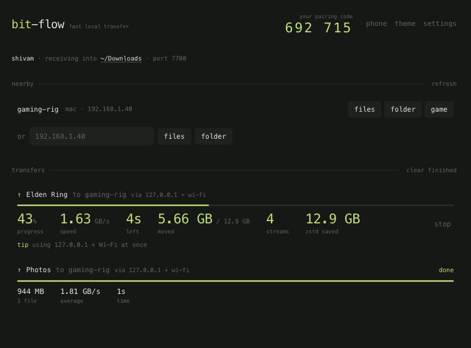
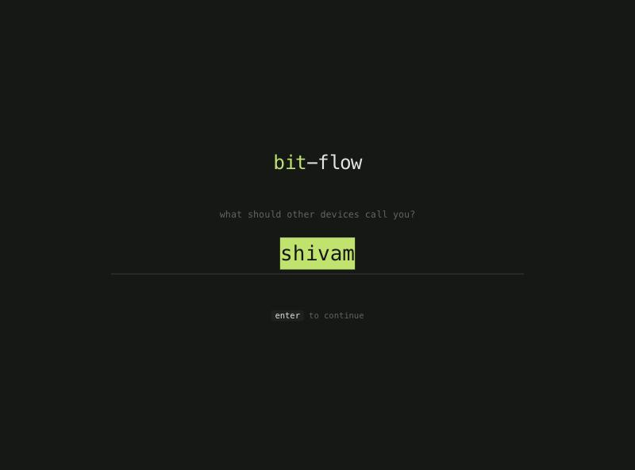
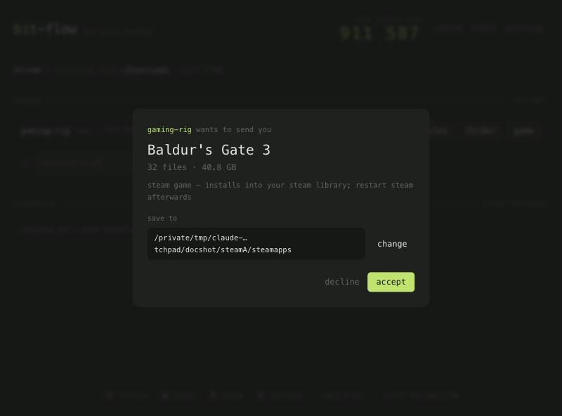
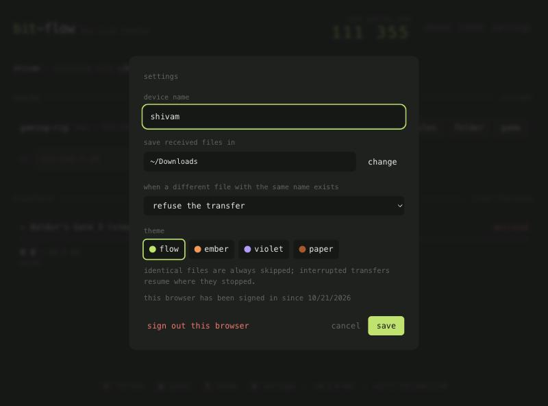
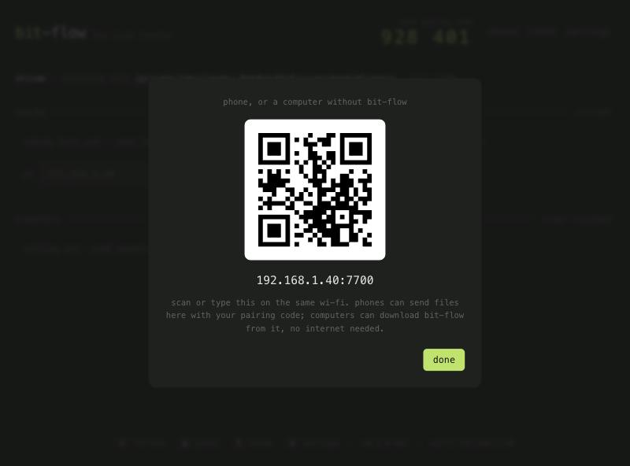

# The app

```bash
bitflow            # or: bitflow ui
```

bit-flow runs a small agent on your computer (receiver, discovery, sender) and opens its interface in
your browser at `http://127.0.0.1:7710`. The browser is only the screen: files are read and written by
bit-flow itself, and the page is only reachable from your own computer.



## First run



The first time a browser opens the app, it asks *what should other devices call you?* That name is what
other laptops see under **nearby** and in their accept prompts. Change it any time in **settings**.

## The main screen

- **Your pairing code** (top right). Whoever sends you files needs it. After 5 wrong attempts it changes
  automatically.
- **Status line**: your device name, the folder incoming files go to (click it to change), and the port.
- **nearby**: other bit-flow computers on the network, found automatically. For each one:
  - **files** / **folder**: opens your system's file picker, then asks for that computer's pairing code
  - **game**: picks one of your installed Steam games (see [Steam games](games.md))
- **or [address]**: type an IP address (`192.168.1.40`, or `192.168.1.40:7711` for another port) when
  discovery can't find the other computer.
- **transfers**: everything in flight and finished, newest first. Running transfers show progress,
  speed, time left, data moved, active streams and how much compression saved, plus which link carries the
  data and a tip if a setup change would help. Use **stop** to cancel. **show** opens the received folder.
  **clear finished** tidies the list (your full history stays available through `bitflow history`).

## Incoming transfers



When someone sends you something, a prompt shows who, what, how big, and where it will be saved:

- **change**: pick another folder for this transfer only
- notes tell you when identical files are already there (they're skipped), when it continues an earlier
  interrupted transfer, when an existing item will be saved as `Name (1)`, or when it's a Steam game going
  into your Steam library
- **accept** / **decline**: click to answer. There are deliberately no keyboard shortcuts for this,
  so a key pressed for something else can never accept or decline a transfer.

Unanswered prompts are declined after 10 minutes.

## Settings



| Setting | What it does |
|---|---|
| device name | what other computers see |
| save received files in | the default folder for incoming transfers |
| when a different file with the same name exists | **refuse the transfer** (default), **keep both** (`rename`), **keep mine, skip theirs** (`skip`), **update: skip identical, replace changed** (`update`), **replace mine** (`overwrite`) |
| theme | **flow** (lime, default), **ember** (orange), **violet**, **paper** (light) |

These are shared with the command line (`bitflow config`). Identical files (same size and modification
time) are always skipped, and interrupted transfers always resume.

## Keyboard shortcuts

| Key | Action |
|---|---|
| `r` | scan for nearby devices again |
| `p` | phone panel: QR code and address of the room, for phones and friends without bit-flow |
| `t` | next theme |
| `s` | settings |
| `enter` / `esc` | confirm / close the send, settings and phone panels |

## Phones and friends without bit-flow



Press `p` (or click **phone**) to show a QR code for your computer's LAN address. Every device that opens it
joins **the room**, where phones, tablets and browsers can send to each other using the code shown on each
device. They can also send you files with your pairing code, and a laptop can download bit-flow from it
without internet. **open the room here** opens it in a browser tab on this computer too.
See [Phones & browsers](phones.md).

## Sessions

The link bit-flow prints when it starts contains a one-time token. When you open it, the page trades the
token for a cookie and removes it from the address bar. After that, `http://127.0.0.1:7710` works directly,
even after restarting bit-flow, so bookmark it. **sign out this browser** in settings forgets the session.
Sessions, your theme, and transfer history are stored in the [config folder](README.md#at-a-glance).

## Options

```bash
bitflow ui --no-browser          # don't open a browser; just print the link
bitflow ui --port 7700           # transfer port (another free port is used if it's taken)
bitflow ui --listen 127.0.0.1:7710
```

If port 7700 is in use (for example by a `bitflow recv` running in a terminal), the app picks another port,
and discovery tells other computers where to find it.
