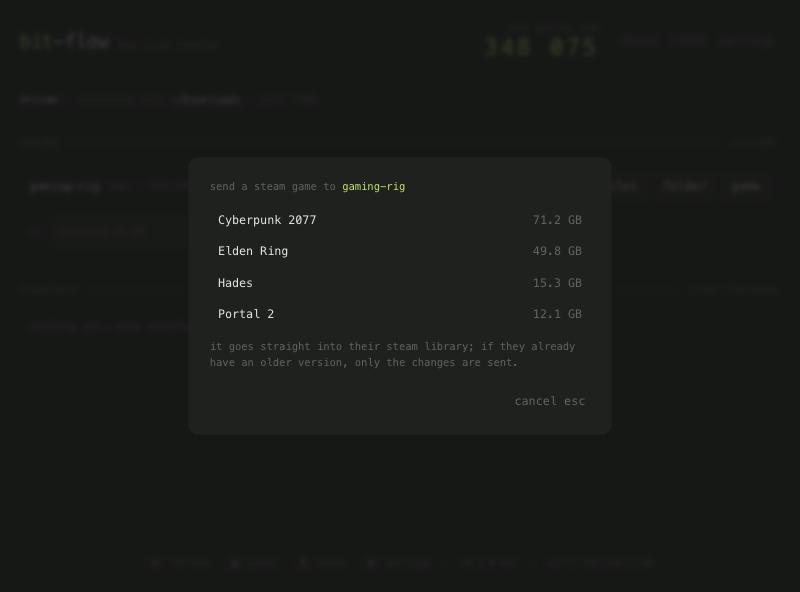

# Steam games

The reason bit-flow exists: a friend comes over, and you hand them a 100 GB game over your network instead
of making them download it again.



## Send a game

**In the app:** click **game** next to the other computer under **nearby**, pick the game, and type their
pairing code.

**On the command line:**

```bash
bitflow games                                     # what's installed
bitflow send --steam "elden ring" --to gaming-rig # by name (case-insensitive, partial is fine)
bitflow send --steam 1245620 --to gaming-rig      # or by Steam app ID
```

```
  Cyberpunk 2077                        71.20 GB   appid 1091500  /Users/shivam/Library/Application Support/Steam
  Elden Ring                            49.80 GB   appid 1245620  /Volumes/Games/SteamLibrary
  Hades                                 15.30 GB   appid 1145360  /Users/shivam/Library/Application Support/Steam
```

## What the receiver sees

The accept prompt says it's a Steam game and where it will be installed: the receiver's **main Steam
library**, straight into `steamapps/`. After it finishes, **restart Steam** and the game shows as installed.
Steam may verify the files on first launch.

On the command line, `recv` does the same automatically. Use `--steam-library PATH` to pick another library,
or `--steam-library -` to save games as plain folders instead.

If the receiver has no Steam installation, the game is saved as a normal folder (`common/<game>` plus its
`appmanifest_<id>.acf`), which you can move into a Steam library later.

## Updates only send what changed

Steam transfers use the **update** policy on the receiving side: files that are identical (same size and
modification time) are skipped, and changed files replace the old ones. If your friend already has an older
version, sending it again moves only the patch. In testing, a changed 300 KB file was the only thing re-sent
out of a game.

## Things to know

- **Platforms.** Games are built per OS. Sending your Windows copy to a Mac works as a file copy, but
  Steam will need to download the Mac version. The prompt warns about this.
- **What's included**: the game's folder under `steamapps/common/` and its `appmanifest_<id>.acf`.
  Workshop content, saves (those live in Steam Cloud) and shader caches aren't included.
- **Only fully installed games** are listed. Games that are mid-download or mid-update are skipped.
- **Where bit-flow looks for Steam:**
  - macOS: `~/Library/Application Support/Steam`
  - Windows: `%ProgramFiles(x86)%\Steam`, `%ProgramFiles%\Steam`
  - Linux: `~/.steam/steam`, `~/.local/share/Steam`, and Flatpak's `~/.var/app/com.valvesoftware.Steam/.local/share/Steam`

  Extra libraries listed in Steam's `libraryfolders.vdf` (other drives) are found automatically. Point
  `BITFLOW_STEAM_ROOT` somewhere else if your Steam lives elsewhere.
