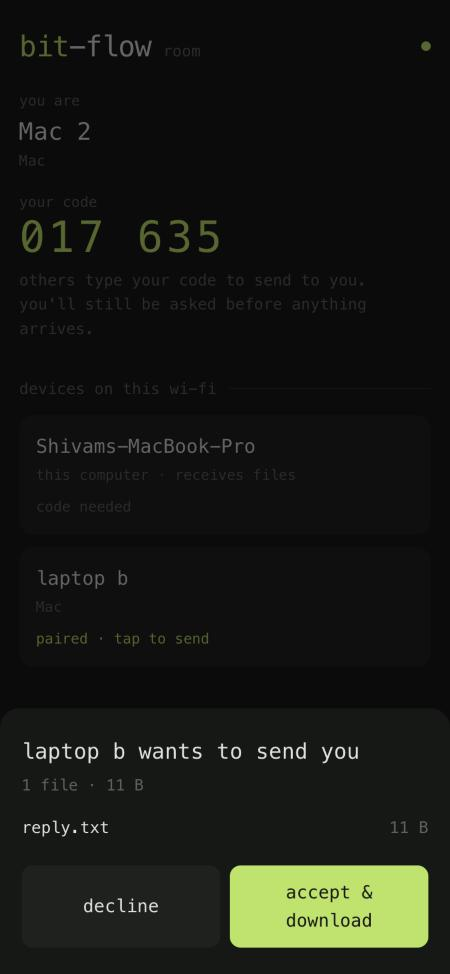
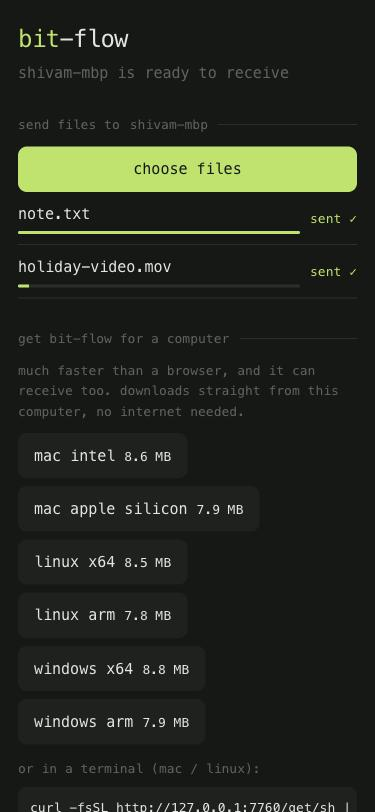

# Phones & browsers: the room

Every bit-flow computer that is running (the app, `bitflow recv`, or `bitflow send --wait`) also answers plain
browsers on its transfer port. The terminal prints the address with a QR code, and in the app you press `p`:

```
Phone, or a computer without bit-flow? Open http://192.168.1.40:7700
  █████████████████████████████
  ██ ▄▄▄▄▄ ██▀▄██▀▀ ▄█ ▄▄▄▄▄ ██
  ...
```

That page is **the room**. Only the computer hosting it needs bit-flow. Every phone, tablet or laptop that
opens it joins, shows up in everyone else's list, and can send files to any other device in the room.

## Send between any two devices



1. Open the address (or scan the QR code) on each device, all on the same Wi‑Fi.
2. Each device shows **your code**, a 6-digit number of its own. Tap the name at the top to rename yourself.
3. Under **devices on this wi-fi**, tap the device you want to send to and pick files (desktop browsers can
   also pick a folder).
4. Type **the code shown on that device's screen** and press **send**.
5. The other device asks *"… wants to send you"*. **accept & download** saves it like any download. Several
   files arrive as one `.zip`.

After two devices have connected once, they show **paired** and can send back and forth with no code. You're
always asked before anything arrives.

How it moves: the sender uploads over plain HTTP, the host computer passes the bytes straight on to the
receiver's download as they arrive (nothing is stored on the host), and the receiver's browser writes them to
disk. That's why big files work even on a phone: nothing is held in the page's memory.

Good to know:

- **Keep the page open** until the transfer finishes. A phone that locks its screen briefly keeps its place
  for 30 seconds and comes back with the same name and code.
- **It runs at about half Wi‑Fi speed**, because the data crosses the air twice (sender → host → receiver).
  For laptop to laptop, install bit-flow on both: it's direct, encrypted and much faster.
- **Folders** can only be picked in desktop browsers. Phones pick files.
- The host computer itself appears as a card in the list (**this computer**). Tap it to send files to it or
  download what it shares, with its pairing code (below).

## Send files to the host computer



1. Open the address (or scan the QR code) on a phone on the same Wi‑Fi.
2. Under **this computer**, enter the computer's 6-digit pairing code.
3. Tap **choose files**. Desktop browsers can also **choose a folder**.

Files are uploaded in 8 MB pieces, four at a time, with automatic retries. They land in the computer's
receive folder. Existing files are never overwritten: a second `IMG_1234.jpg` is saved as
`IMG_1234 (1).jpg`. Uploads abandoned for 15 minutes are cleaned up.

## Download files from the host computer

On the computer:

```bash
bitflow send ~/Videos/trip.mov ~/Pictures/Album --wait
```

The phone opens the address, enters the code, and gets a download button for each item. Files support
resuming (HTTP Range requests). Folders download as a `.zip`, streamed directly with no temporary copy.

## Give bit-flow to a laptop that doesn't have it

The same page offers bit-flow itself for every OS this computer has a copy of. No internet needed:

- click the button for your OS on the page, or
- macOS / Linux: `curl -fsSL http://192.168.1.40:7700/get/sh | sh` (installs to `~/.local/bin`; set
  `BITFLOW_DIR` to choose another folder)
- Windows PowerShell: `iwr http://192.168.1.40:7700/get/windows-amd64.exe -OutFile bitflow.exe`

A computer always offers its own build. To offer the others too, put the cross-compiled binaries
(`make cross` → `dist/bitflow-<os>-<arch>`) next to the `bitflow` executable or in a `dist/` folder
beside it.

## Good to know

- **Same network only.** Phones must be on the same Wi‑Fi (or the computer's hotspot).
- **Codes protect everything.** Anyone on your network can open the page and join the room, but sending to a
  device needs the code shown on it, and the receiver still has to accept. Files on the host computer need its
  pairing code. Every wrong guess waits 1 s, and 5 wrong guesses change the code.
- **Browser traffic is not encrypted.** Browser HTTP on the LAN is plain text; anyone else on the same Wi‑Fi
  could in principle watch it, and the host computer passes room transfers along so it could read them. Fine
  at home. Use the bit-flow app between computers for anything sensitive. See [Security](security.md).
- **It's the slow lane.** Browsers are capped well below what two bit-flow apps achieve. For big
  transfers between laptops, install bit-flow on both.
